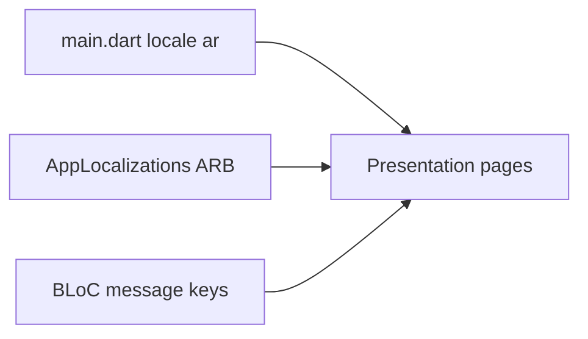

# المرحلة الأولى: التعريب ودعم RTL

نعم: الخطة مفهومة، والبنية الحالية مطابقة لما وصفته (ميزات `billing` / `product` / `settings` / `shop`، BLoC، Hive في `[lib/core/data/hive_database.dart](lib/core/data/hive_database.dart)`).

**هذه الخطة تغطي المرحلة الأولى فقط.** بعد تنفيذها ومراجعتك، ننتقل للمرحلة التالية (العملة بشكل أعمق / الطابعة / الماسح / الترخيص...) حسب توجيهك.

## الوضع الحالي (موجز)

- `[lib/main.dart](lib/main.dart)`: `MaterialApp.router` بدون `locale` ولا `localizationsDelegates` ولا اتجاه.
- لا يوجد `flutter_localizations` في `[pubspec.yaml](pubspec.yaml)` (يوجد `intl` فقط).
- الخط `[GoogleFonts.ibmPlexSans](lib/core/theme/app_theme.dart)` ضعيف للعربية.
- كل النصوص ظاهرة بالإنجليزية؛ الأسعار تستخدم `₹` (روبية هندية) في الرئيسية، الدفع، المنتجات.
- أزرار الرجوع ثابتة `Icons.chevron_left` و`Positioned(right: ...)` فلا تنعكس مع RTL.
- رسائل BLoC إنجليزية (منتج غير موجود، نجاح الإضافة، الطابعة...).

## قرار التنفيذ (مرحلة 1)

- التطبيق **عربي فقط** (`locale: Locale('ar')`) مع `supportedLocales: [Locale('ar')]`.
- استخدام **Flutter gen-l10n** (`l10n.yaml` + `lib/l10n/app_ar.arb`) حتى تبقى النصوص خارج الـ widgets وتبقى طبقات Clean Architecture سليمة.
- خط الواجهة: `GoogleFonts.ibmPlexSansArabic()` بدل IBM Plex Sans اللاتيني.
- في نفس المرحلة نعوّض الرمز الهندي في **عرض الأسعار فقط** بدالة تنسيق `ج.م` / EGP في `[lib/core/utils/currency_format.dart](lib/core/utils/currency_format.dart)` لأن الواجهات الرئيسية تظهر `₹` اليوم. **لا** نلمس طباعة الإيصال ولا QR الـ UPI (هند) — ذلك مراحل لاحقة.

**خارج النطاق الآن:** تعديل `[printer_helper.dart](lib/core/utils/printer_helper.dart)`، تحسين `[scanner_page.dart](lib/features/billing/presentation/pages/scanner_page.dart)` وظيفياً، الترخيص، التقارير، حقل الكمية في المنتج، `build_runner`/Hive adapters.

## 1) إعداد التعريب

في `[pubspec.yaml](pubspec.yaml)`:

- إضافة `flutter_localizations` من الـ SDK.
- `generate: true` تحت `flutter:`.

ملف جديد `[l10n.yaml](l10n.yaml)`:

- `arb-dir: lib/l10n`
- `template-arb-file: app_ar.arb`
- `output-localization-file: app_localizations.dart`

ملف `[lib/l10n/app_ar.arb](lib/l10n/app_ar.arb)`: كل عناوين الشاشات، الأزرار، التلميحات، رسائل التحقق، ونصوص BLoC بعد تحويلها لمفاتيح.

تشغيل `flutter gen-l10n` (أو build عادي) لتوليد `AppLocalizations`.

## 2) `main.dart` والثيم

تعديل `[lib/main.dart](lib/main.dart)`:

- استيراد `flutter_localizations` و`AppLocalizations`.
- على `MaterialApp.router`:
  - `locale: const Locale('ar')`
  - `supportedLocales: const [Locale('ar')]`
  - `localizationsDelegates`: `AppLocalizations.delegate` + delegates المادية/Cupertino/Widgets
  - `title` من l10n أو ثابت عربي مثل «تطبيق الفواتير»
- RTL يأتي تلقائياً من locale العربية؛ لا حاجة لـ `Directionality` يدوي إلا إذا ظهر استثناء.

تعديل `[lib/core/theme/app_theme.dart](lib/core/theme/app_theme.dart)`: `ibmPlexSansArabicTextTheme`.

## 3) الواجهات الرئيسية والفرعية

استبدال النصوص الإنجليزية بـ `AppLocalizations.of(context)!` في:

- `[home_page.dart](lib/features/billing/presentation/pages/home_page.dart)`
- `[checkout_page.dart](lib/features/billing/presentation/pages/checkout_page.dart)`
- `[scanner_page.dart](lib/features/billing/presentation/pages/scanner_page.dart)` (نصوص فقط)
- `[settings_page.dart](lib/features/settings/presentation/pages/settings_page.dart)`
- `[product_list_page.dart](lib/features/product/presentation/pages/product_list_page.dart)`
- `[add_product_page.dart](lib/features/product/presentation/pages/add_product_page.dart)`
- `[edit_product_page.dart](lib/features/product/presentation/pages/edit_product_page.dart)`
- `[shop_details_page.dart](lib/features/shop/presentation/pages/shop_details_page.dart)`
- `[app_validators.dart](lib/core/utils/app_validators.dart)`: رسائل افتراضية بالعربية عبر l10n من الصفحات (الدالة تبقى تستقبل `message`)

RTL عملي:

- أزرار الرجوع: `Icons.arrow_back` (ينعكس مع الاتجاه) بدل `chevron_left`.
- `[home_page](lib/features/billing/presentation/pages/home_page.dart)`: أزرار الكاميرا بـ `PositionedDirectional(end: 16, ...)`.
- `[input_label.dart](lib/core/widgets/input_label.dart)`: `EdgeInsetsDirectional.only(start: 4, bottom: 8)`.
- `[settings_page](lib/features/settings/presentation/pages/settings_page.dart)`: `AlignmentDirectional.centerStart`.
- جداول الدفع: `TextAlign.start` / `TextAlign.end` بدل left/right.
- تلميحات المتجر الهندية (Mecheri / Salem / +91) تُستبدل بأمثلة مصرية في الـ ARB فقط.

## 4) رسائل BLoC بدون خلط طبقات

الـ BLoC يبقى بدون `BuildContext`. نستخدم **مفاتيح خطأ** ثابتة (مثل `productNotFound`) في `[billing_bloc.dart](lib/features/billing/presentation/bloc/billing_bloc.dart)` و`[product_bloc.dart](lib/features/product/presentation/bloc/product_bloc.dart)` و`[printer_bloc.dart](lib/features/settings/presentation/bloc/printer_bloc.dart)`، والـ UI يترجمها عبر l10n في `SnackBar` / المستمعين.

قيم المتجر الافتراضية في `[shop_repository_impl.dart](lib/features/shop/data/repositories/shop_repository_impl.dart)` تُحدَّث لنصوص عربية/مصرية حتى لا يظهر «Dinesh Shop» لمتجر جديد.

## 5) التحقق بعد التنفيذ

- تشغيل التطبيق والتأكد أن كل الشاشات من اليمين لليسار.
- Material (تلميحات النظام، إن وُجدت) بالعربية.
- الأسعار تظهر بجنيه مصري في الرئيسية / الدفع / قائمة المنتجات.
- لا تغيير في Hive schemas ولاطباعة حرارية في هذه المرحلة.

## بعد المرحلة الأولى (لا تنفيذ حتى تأمر)

1. الطابعة الحرارية + العربية + رقم فاتورة منسق.
2. الماسح: استجابة أسرع + إدخال يدوي.
3. نظام الترخيص وDevice ID.
4. لوحة التقارير.
5. المخزون وخصم الكمية عند الدفع.

انتظر توجيهك بعد مراجعة المرحلة الأولى قبل أي مرحلة تالية.